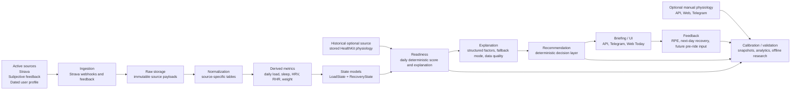

# System Map

As of 2026-10-17 (Europe/Moscow), reviewed against `main` / `9013921` and
live GitHub issue metadata. `Implemented` describes repository capability;
`partial` describes remaining scope, not absence of the baseline. Tests and
documented production evidence are distinguished in the
[current-state evidence table](../product/CURRENT_STATE.md).
No production data or experiments were accessed for this review.

## 1. Executive overview

Whatte is a deterministic training readiness and recovery system.

It solves one core problem:

> given mixed real-world training and recovery data, determine current physiological readiness and turn that into an explainable daily training decision

The active core uses Strava load plus response and subjective feeling. Preserved
HealthKit history can enrich the matching historical date, but wearable data is
not collected and is not required by the current daily loop.

Core boundary:

- deterministic core first
- AI is auxiliary for explanation, formatting, and developer workflows
- AI does not define readiness, recovery, or recommendation logic

## 2. End-to-end system flow



ASCII view:

```text
sources
-> ingestion
-> raw storage
-> normalization
-> derived metrics
-> state models
-> readiness
-> explanation
-> recommendation
-> briefing / UI
-> feedback
-> calibration / validation
```

## 3. Data sources

### Implemented

- Strava: workout/activity ingestion and daily load inputs
- Dated user profile: FTP, HR max and weight histories are managed through protected
  Web Today forms. FTP is resolved on or before each activity's local date;
  profile edits can trigger an explicit stored-data-only recomputation.
- Subjective feedback: Web/Telegram recovery and source-aware effective RPE;
  current 1–10 RPE stays separate from legacy 1–5.
- Optional manual sleep/HRV/RHR observations: API, Telegram and Web share one
  backend contract; personal-relative derived features feed research, not an
  implicit replacement for historical physiology in readiness. See
  [manual physiology](../models/PERSONAL_PHYSIOLOGY_FEATURES.md).

### Historical

- Apple Health / HealthKit raw, normalized, and recovery rows are preserved
- collection endpoints and the iOS client are retired
- an exact-date historical recovery row may enrich readiness for that date only

### Planned

- Equipment data: bike, components, maintenance state for ride preparation
- Calendar and daily context data: discussed in product direction for time-aware recommendations and morning briefings

### Future

- Optional provider integrations behind the provider-neutral physiology boundary

## 4. Backend layers

### API layer

Status: `implemented`

- FastAPI backend is the system entry point
- exposes Strava sync, recompute, readiness read, notification/debug, callback paths, and the internal SSR dashboard route
- current repo evidence:
  - `backend/backend/app.py`
  - `backend/backend/dashboard/`
  - `backend/backend/templates/dashboard/`
  - readiness API docs in `docs/api/READINESS_API.md`

### Ingestion layer

Status: `implemented`

- Strava webhook + ingest jobs
- Web/API and Telegram feedback persistence, dated profile and optional manual observations

### Raw tables

Status: `implemented`

- raw source payloads are preserved for reproducibility
- current documented/raw entities include:
  - `strava_webhook_event`
  - `strava_activity_ingest_job`
  - `strava_activity_raw`
  - `healthkit_ingest_raw`

`healthkit_ingest_raw` is historical storage and has no active public write path.

### Normalized tables

Status: `implemented`

- source payloads are normalized into explicit tables rather than used directly in product logic
- current normalized tables include:
  - `health_sleep_night`
  - `health_resting_hr_daily`
  - `health_hrv_sample`
  - `health_weight_measurement`

### Derived metric tables

Status: `implemented`

- `daily_training_load`
- `health_recovery_daily`
- other per-day derived fields embedded in recovery and readiness explanation payloads

### Readiness / recovery / load state

Status: `implemented`

- `load_state_daily_v2`
- `health_recovery_daily`
- `readiness_daily`

### Recommendation layer

Status: `partial`

- narrow baseline is implemented in [decision_engine](../../backend/backend/services/decision_engine.py)
- [readiness_query](../../backend/backend/services/readiness_query.py) and
  [notification_service](../../backend/backend/services/notification_service.py)
  use the shared persisted-readiness briefing contract
- current implementation is still a narrow readiness-to-zone mapping, not a full ride preparation system
- important separation:
  - readiness calculates physiological state
  - recommendation maps state into action guidance

### Notification / briefing layer

Status: `partial`

- Telegram daily readiness delivery exists
- Telegram post-ride and next-day recovery prompts exist
- readiness briefing exists as deterministic text formatting
- delivery formatting is surface-specific; this is not a missing shared decision layer
- [#108 production pilot](https://github.com/shchukins/whatte/issues/108#issuecomment-5802313089)
  verifies persisted delivery; historical rendered consistency remains unmeasurable

### Web Today interaction surface

Status: `implemented`

- `/today` is a mobile-friendly FastAPI/Jinja2 surface protected at the Caddy edge
- it reads backend-owned readiness, recommendation, explanation availability,
  and freshness state
- it reuses idempotent subjective-feedback persistence for morning recovery and
  latest-activity RPE
- recovery submission triggers backend readiness recomputation; frontend code
  contains no readiness or recommendation formula
- missing physiology is rendered as unavailable rather than as an error
- unified answer/disclosure, explicit score save, retained failed input, server-day
  guards and Today/Profile BFCache/tab-return recovery are implemented
- optional physiology collection remains separate from readiness recomputation

### Profile and Diary interaction surfaces

Status: `implemented baseline`

- `/today/profile`: dated FTP/HR max/weight, separate save/recompute, retained
  errors and pending notices shared with Today/Diary
- `/today/diary`: 14 local dates, effective-RPE filter, historical activity return,
  readable date/week sections and factual seven-day summary
- load eligibility is backend-owned; eligibility does not prove current readiness
  has already incorporated that activity
- [UX contract and validation](../ui/READINESS_TODAY_SCREEN.md),
  [profile contract](../product/USER_PROFILE.md),
  [Diary tests](../../backend/tests/test_today_diary.py);
  [#153](https://github.com/shchukins/whatte/issues/153) and
  [#169](https://github.com/shchukins/whatte/issues/169) are closed
- RPE guidance, independent selection before personal-history comparison, and
  descriptive PED are implemented; [history](../api/RPE_HISTORY.md),
  [PED](../models/PERCEIVED_EFFORT_DEVIATION.md). PED does not affect readiness.

### Observability

Status: `implemented`

- structured JSON logs
- Docker stdout -> Promtail -> Loki -> Grafana
- FastAPI SSR dashboard for current production operational state
- observability is operational only and must not become product logic

## 5. Storage and processing model

```text
external source payloads
-> raw immutable tables
-> normalized source tables
-> derived daily aggregates
-> state materializations
-> decision and delivery outputs
-> outcome / feedback storage
-> calibration analytics and research exports
```

Current storage examples by layer:

- Raw:
  - `strava_activity_raw`
  - `healthkit_ingest_raw`
- Normalized:
  - `health_sleep_night`
  - `health_resting_hr_daily`
  - `health_hrv_sample`
  - `health_weight_measurement`
  - `manual_physiology_observation` (with revision evidence)
- Derived:
  - `daily_training_load`
  - `health_recovery_daily`
  - `activity_response_metrics`
  - `personal_physiology_feature_daily` (research)
- State:
  - `load_state_daily_v2`
  - `readiness_daily`
- Feedback / evaluation:
  - `activity_subjective_feedback`
  - `subjective_feedback_prompt_log`
  - `decision_context_snapshot`
  - `research_feature_snapshot` (immutable v1/v2 inputs)
  - `research_experiment` (metadata/audit, not personal datasets)

Design intent:

- raw data is preserved
- normalized and derived layers are explicitly separated
- state models are recomputable from stored upstream layers
- feeling and usable RPE-derived response affect readiness only through the existing
  versioned composition; outcome evidence never silently retunes that composition

## 6. Model layers

### LoadState

Status: `implemented`

Materialized in:

- `load_state_daily_v2`

Current role:

- models training load accumulation and decay on a continuous calendar axis
- exposes `fitness`, `fatigue_fast`, `fatigue_slow`, `fatigue_total`, `freshness`

### RecoveryState

Status: `implemented`

Materialized in:

- `health_recovery_daily`

Current role:

- converts preserved historical sleep/HRV/resting-HR evidence into a daily recovery contour
- manual personal-relative physiology remains a separate research feature path
- stores both the aggregate score and explanation payload

### Readiness

Status: `implemented`

Materialized in:

- `readiness_daily`

Current role:

- composes explicit `load`, `freshness`, `response`, `feeling`, and optional
  `physiology` signal families
- remains separate from raw freshness and separate from downstream recommendation
- works without HealthKit; missing physiology is unavailable rather than negative

Current baseline formula:

```text
freshness_norm = clamp(50 + freshness, 0, 100)
feeling_norm = (feeling_score - 1) * 25
readiness_score_raw = weighted average of available scored signal families
readiness_score = clamp(round(readiness_score_raw, 1), 0, 100)
```

`freshness` has configured weight `0.6`. Baseline-backed `response` receives up
to `0.2` from the `0.4` evidence budget; available `feeling` and `physiology`
share the remainder. Missing response returns that budget to recovery evidence
and therefore preserves the previous formula exactly.
Current writes use version `v2_signal_composition_response_v1`; legacy `v2` and
`v2_signal_composition` rows remain stored.

### GoodDayProbability

Status: `implemented baseline`

- stored in `readiness_daily`
- current mapping is:

```text
good_day_probability = readiness_score / 100
```

Important constraint:

- this is not yet a calibrated statistical probability
- it is a probability-like presentation layer over readiness

### Confidence / freshness / data quality

Status: `partial`

- `data_quality` already appears in readiness API responses
- fallback modes are already explicit in explanation payloads
- freshness of sync and confidence semantics are important, but not yet formalized as one coherent production model

This is a cross-cutting concern, not a separate model:

- source freshness affects trust in the answer
- data completeness affects fallback mode
- continuity gaps affect interpretation
- future calibration quality depends on storing this context explicitly

### Recommendation / decision layer

Status: `partial`

- currently implemented as deterministic mapping and briefing templates
- should remain downstream from readiness
- must not recalculate physiology or silently blend in AI reasoning

Current implemented basis:

- recommendation zones from readiness score
- rule-based explanation strings
- briefing text for readiness API and Telegram

Still missing for a fuller production decision system:

- explicit decision objects with richer constraints
- stable freshness/confidence-aware recommendation policy
- integrated ride preparation context such as equipment and calendar

## 7. Product loops and scenario epics

The current scenario-epic framing is the best product-level view of the system.

### 7.1 Morning Readiness Loop

Status: `partial`

System map slice:

- scheduled local-day orchestration
- load state continuity
- readiness recompute
- freshness-aware daily delivery

Current state:

- local-day recompute, persisted-readiness answer, explicit freshness states and
  scheduled delivery are implemented ([pipeline tests](../../backend/tests/test_daily_readiness_pipeline.py))
- [#108](https://github.com/shchukins/whatte/issues/108) is complete; broader
  [#91](https://github.com/shchukins/whatte/issues/91) remains open, and the pilot
  did not establish rendered-surface consistency or outcome benefit

### 7.2 Explainable Readiness Experience

Status: `partial`

System map slice:

- `readiness_daily`
- explanation payloads
- `data_quality`
- deterministic recommendation reason
- history API for trend context

Current state:

- Today unified answer and expandable factors, 7-day overview and 14-day Diary
  exist; [#154–#161 scope](https://github.com/shchukins/whatte/issues/153) is complete
- [#92](https://github.com/shchukins/whatte/issues/92) remains a broader open
  scenario; completed UI is not evidence of a calibrated confidence model

### 7.3 Ride Preparation and Recommendation Loop

Status: `partial`

System map slice:

- readiness
- deterministic recommendation
- ride briefing
- future equipment/context constraints

Current state:

- baseline recommendation and briefing exist
- broader ride preparation layer is still not implemented as a full system

### 7.4 Post-Workout Feedback Loop

Status: `implemented baseline`

System map slice:

- activity ingestion
- Telegram RPE prompt
- next-day recovery prompt
- prompt log
- subjective feedback storage

Current state:

- feedback storage and prompt orchestration exist
- Web/Telegram entry, source precedence, explicit editing and RPE history/PED exist
- [#94](https://github.com/shchukins/whatte/issues/94) remains broader scenario scope

### 7.5 Readiness Calibration Loop

Status: `partial`

System map slice:

- readiness snapshots
- recommendation context snapshots
- subjective outcomes
- analytics joins
- validation exports

Current state:

- the feedback dataset layer exists
- [#77 records/summary](../data/CALIBRATION_RECORDS.md), immutable feature snapshots,
  temporal exports and frozen evaluator exist
- numerical model-error verdicts and outcome benefit remain unestablished;
  [#95](https://github.com/shchukins/whatte/issues/95) and
  [#77](https://github.com/shchukins/whatte/issues/77) remain open
- production decision logic is not auto-adapting from feedback

### 7.6 Research Sandbox

Status: `partial` — implemented infrastructure and offline models; acceptance pending

- [feature v1/v2](../models/DAILY_FEATURE_VECTOR.md),
  [temporal datasets](../data/TEMPORAL_DAY_DATASET.md),
  [frozen evaluator](../product/RESEARCH_EVALUATOR.md),
  [audit](../product/RESEARCH_EXPERIMENTS.md) and
  [bounded parameter space](../product/RESEARCH_PARAMETER_SPACE.md) exist
- [runner](../product/RESEARCH_RUNNER.md) isolates fixed candidate/evaluator
  containers, with bounded resources, no network/DB credentials in workers,
  private receipts and a separate audit writer
- [recovery predictor](../models/RECOVERY_PREDICTION.md) implements train-only
  affine prediction of next-day recovery, immutable replay and paired MAE;
  this is separate from production readiness and broader product prediction #55
- [#150](https://github.com/shchukins/whatte/issues/150) and
  [#136](https://github.com/shchukins/whatte/issues/136) remain open pending
  natural capture linkage, adequate real evidence and home-server acceptance
  under the [runbook](../product/RECOVERY_RESEARCH_ACCEPTANCE.md)
- [PED study #196](../product/PED_RESEARCH.md) is implemented, with documented
  delivery verification on 2026-10-16; its 2026-10-15 availability report remains
  `insufficient evidence` (0 eligible train days in the inspected window).
  It does not accept #150/#136
- [#138 search](https://github.com/shchukins/whatte/issues/138) is planned and
  blocked by #150/#136 acceptance; #139–#143 LLM planning, promotion governance,
  scheduling and research UI remain backlog under
  [#125](https://github.com/shchukins/whatte/issues/125)

Boundary: offline reproducible evidence, protected test partition, no automatic
promotion or production tuning. Infrastructure, successful synthetic tests and
closed child issues do not establish an accepted research MVP or model benefit.
GitHub scenario issues #91–#96 were accessible and reviewed on 2026-10-17;
they remain open and describe broader scenarios than their implemented slices.

## 8. UI and delivery surfaces

### iOS app

Status: `retired`

- the iOS client and Xcode project were removed from the repository
- HealthKit collection is no longer an active product capability
- historical backend records remain intact

### Telegram bot / notifications

Status: `implemented baseline`

- daily readiness notifications
- post-ride RPE prompt
- next-day recovery prompt
- callback-based feedback collection

### Web Today / morning briefing

Status: `implemented baseline`

- mobile-friendly Web Today surface
- scheduled local-day readiness recompute and Telegram delivery
- explicit optional physiology availability

### Internal dashboard

Status: `implemented baseline`

- current route: `/dashboard`
- public path: `https://shchukin.de/dashboard`
- served as FastAPI SSR HTML with Jinja2 templates and minimal CSS
- protected by `Caddy` Basic Auth; Google OAuth remains a future authorization improvement
- current sections:
  - `System`: backend status, database status, server time, process start time, uptime, and database error fallback
  - `Connection`: Strava connection status, athlete id, scope, token expiry, and token state
  - `Ingest Jobs`: latest ingest jobs plus pending and failed/error counts
  - `Strava Activities`: latest locally stored activities and total count
- section errors must not break page rendering
- dashboard is read-only, local-state-only, and must not call Strava API, refresh tokens, mutate database state, show raw payloads, or expose secrets
- dashboard is the primary current operational monitoring surface for the VPS production backend
- old home-server Telegram watchdog / cron monitoring is legacy and not the primary production monitoring channel

### Future dashboards

Status: `planned` / `future`

- readiness history is already available in Today/Diary
- broader calibration UI (#80) and research summary UI (#143) remain planned
- `/dashboard` remains operational observability, separate from these product views

## 9. Feedback and calibration

Why feedback is collected:

- readiness and recommendation need downstream ground truth
- deterministic state alone does not reveal whether the athlete actually felt good, overreached, or recovered well
- repeated low-friction observations are required for validation

Current feedback families:

- post-ride RPE
- next-day recovery
- future pre-ride subjective readiness

How these relate to calibration:

- RPE helps evaluate perceived training cost
- next-day recovery helps evaluate delayed recovery impact
- subjective readiness can later be compared with system-predicted readiness

Why feedback does not directly mutate the model:

- production readiness must remain deterministic and reproducible
- feedback is also an observed outcome layer; existing feeling/response inputs
  can affect scores without changing model rules
- calibration should produce explicit research or rule-change decisions, not hidden online adaptation

What must be stored for future validation:

- feedback value and normalized score
- feedback type and source
- activity/date linkage
- readiness snapshot at feedback time
- recommendation snapshot at feedback time
- model version
- data quality / fallback context when available
- prompt delivery state for longitudinal collection quality

## 10. Observability and operations

### Structured logs

Status: `implemented`

- backend emits JSON logs with stable event names
- examples include API, Strava ingest, readiness recompute, and error events

### Grafana / Loki

Status: `implemented`

- Promtail parses backend logs
- Loki stores/indexes logs
- Grafana is the operational view for traces, event timelines, durations, and failures

### Pipeline diagnostics

Status: `implemented baseline`

- readiness recompute events
- request tracing via request IDs
- feedback prompt delivery persistence in `subjective_feedback_prompt_log`

### Offline validation

Status: `implemented / partial`

- calibration joins, dataset export validation and frozen model comparison exist
- #77 descriptive review cases are not numerical over/underestimation verdicts
- bounded batch search (#138) and scheduled research (#142) remain planned

Important boundary:

- observability explains system behavior
- observability does not define readiness or recommendation logic

## 11. Current gaps

- Recommendation layer is only partially implemented as a readiness-to-zone mapping plus briefing templates; it is not yet a full ride preparation engine.
- Data confidence, freshness, and trust semantics are important but not yet formalized into one consistent production model.
- `good_day_probability` exists, but it is not yet a calibrated probability model.
- Calibration is not production ML; current feedback storage supports validation, not online adaptation.
- Research Sandbox has implemented infrastructure/models; #150/#136 real-data and
  operational acceptance remains pending, blocking #138. Offline review gates remain.

## 12. Simplification rule

Any future addition should fit this chain:

```text
source -> raw -> normalized -> derived -> state -> readiness -> decision -> delivery -> feedback -> calibration
```

If a proposed feature bypasses this chain, it should be challenged:

- does it belong in deterministic production logic
- is it actually a delivery concern
- is it calibration/research instead of state computation
- is it trying to hide a model change behind AI or UI wording
